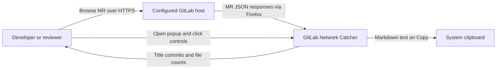
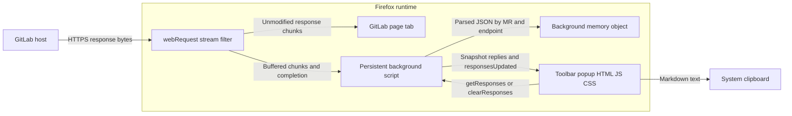
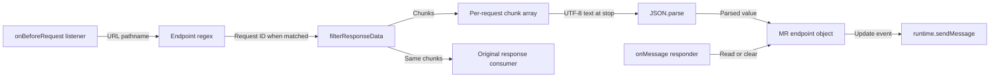
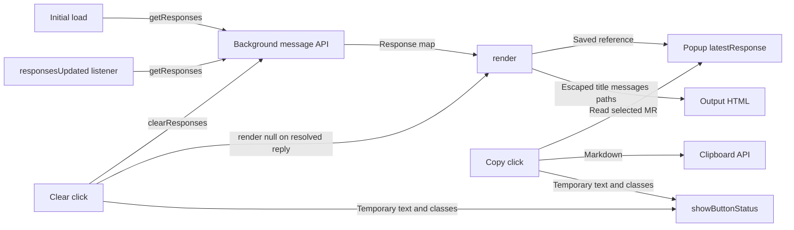

# 03 — Architecture

Purpose: explain runtime boundaries, dependencies, state and design trade-offs. Intended reader: architect or senior developer. Last verified against commit `9b02e7db044bfa763c69c7b956fa379ee3ddd2d0` (2026-10-15).

## System context

**[Verified]** The context below follows the host-scoped listener, toolbar popup, and clipboard call ([background.js:67](../background.js#L67), [manifest.json:17](../manifest.json#L17), [popup.js:112](../popup.js#L112)). **[Inferred]** The user is a developer/reviewer; GitLab's own authentication and persistence are external to this repository.

**[Verified]** Caption: the extension observes page traffic and exports a summary. How to read this: edges name data or user actions, not server calls made by the extension. [Rendered SVG](diagrams/03-architecture-1.svg).

## Runtime containers

**[Verified]** “Container” here means a runtime context, not Docker. No container infrastructure is present; the background and popup are wired by the manifest and runtime messages ([manifest.json:13](../manifest.json#L13), [popup.js:149](../popup.js#L149)).

**[Verified]** Caption: the only application store lives in the persistent background context. How to read this: the return path to the page passes through the filter, while extension messages carry data to the popup. [Rendered SVG](diagrams/03-architecture-2.svg).

## Background module components

**[Verified]** There are no exported modules or classes; these components are responsibilities within one global script ([background.js:1](../background.js#L1), [background.js:72](../background.js#L72)).

**[Verified]** Caption: response observation and local control meet at one in-memory object. How to read this: buffering belongs to each request; storage is shared across requests and tabs ([background.js:17](../background.js#L17), [background.js:41](../background.js#L41)). [Rendered SVG](diagrams/03-architecture-3.svg).

## Popup module components

**[Verified]** The HTML supplies three DOM element IDs, and the JS connects rendering, actions, and messages ([popup.html:15](../popup.html#L15), [popup.html:19](../popup.html#L19), [popup.js:1](../popup.js#L1)).

**[Verified]** Caption: the popup stores a snapshot for export and fetches again after updates. How to read this: the Copy action reads popup state; it does not first ask the background for fresher data ([popup.js:94](../popup.js#L94)). [Rendered SVG](diagrams/03-architecture-4.svg).

## Style, dependency direction and boundary leaks

**[Inferred]** This is an event-driven observer with a shared mutable store and a message-based UI boundary: incoming webRequest events mutate state, notifications trigger reads, and UI actions send control messages. This characterization follows [background.js:7](../background.js#L7), [background.js:50](../background.js#L50), and [popup.js:149](../popup.js#L149). There is no dependency injection, framework router, domain layer, queue worker or module import graph in either JavaScript file.

**[Verified]** Load dependency direction is manifest → background and popup HTML → CSS/JS. Runtime communication is bidirectional but no circular source import exists. **[Inferred]** The abstraction leaks because the entire raw upstream object is returned to the popup, which independently knows GitLab field names and MR selection rules ([background.js:75](../background.js#L75), [popup.js:24](../popup.js#L24), [popup.js:94](../popup.js#L94)). A normalized summary DTO (data transfer object) could isolate upstream schema changes, at the cost of another transformation layer.

## State, asynchronous work and concurrency

| Concern | Behavior and implication |
|---|---|
| State ownership | **[Verified]** Background `latestResponse` is authoritative; popup has a second variable with the same name ([background.js:4](../background.js#L4), [popup.js:5](../popup.js#L5)). No browser storage API is used. |
| “Cache” behavior | **[Verified]** Each MR/endpoint slot retains the last successfully parsed response, without timestamp, TTL (time to live), eviction, or project key ([background.js:36](../background.js#L36)). **[Inferred]** Endpoint data can be from different visits and capture times. |
| Concurrent requests | **[Verified]** Each listener call owns its chunks, and `onstop` writes the shared slot ([background.js:17](../background.js#L17), [background.js:24](../background.js#L24)). **[Inferred]** Last completion wins for the same slot, not necessarily newest request start. |
| Refresh | **[Verified]** Every successful parse sends a notification; each received notification initiates a full-store read ([background.js:50](../background.js#L50), [popup.js:153](../popup.js#L153)). No debounce, cancellation, sequencing or revision check exists. **[Inferred]** Rapid completions can cause redundant rendering; stale replies have no explicit rejection rule. |
| Clear | **[Verified]** Sets background state to `null` and replies; does not cancel in-flight filters or broadcast the clear ([background.js:79](../background.js#L79)). **[Inferred]** Later completion can repopulate state; another already-open extension context can remain stale. |
| Queue/timers | **[Verified]** No explicit queue, scheduler or retry loop. `setTimeout` only restores button text/classes ([popup.js:135](../popup.js#L135)). **[Inferred]** Repeated clicks can restore an intermediate status because each timer snapshots the current label. |

## Reliability and scale limits

**[Verified]** Capture forwards each data chunk before JSON parsing; parse errors log and disconnect without updating state ([background.js:19](../background.js#L19), [background.js:55](../background.js#L55)). Filter errors disconnect and log; filter creation and `ondata` writes are outside the `onstop` try/catch ([background.js:16](../background.js#L16), [background.js:62](../background.js#L62)). **[Unknown]** The effect of stream API failure on real page loading has not been browser-tested.

**[Inferred]** Memory and transfer costs are the principal scaling concern. A response keeps all original chunks, a contiguous buffer, decoded text and parsed data during processing; stored MR count has no upper bound. Popup reads transfer the entire retained map, then render only one entry ([background.js:26](../background.js#L26), [background.js:75](../background.js#L75), [popup.js:24](../popup.js#L24)). Rendering/export traverses all files and commits of that selected MR. No pagination, virtualization, size limit or truncation exists. There is no application-issued database query or N+1 network query pattern; the extension issues zero GitLab requests itself.

**[Inferred]** The background is a single local state owner and failure point for capture, with no durable recovery. This is a stateful per-browser design, not a horizontally scalable service. **[Unknown]** Maximum practical MR size, memory use, and supported concurrency require measurement.

## Security boundaries

**[Verified]** Host permission and listener filter name the same HTTPS host; the listener does not inspect tab, initiator, HTTP status, content type or method ([manifest.json:6](../manifest.json#L6), [background.js:9](../background.js#L9), [background.js:67](../background.js#L67)). The regex is not end-anchored. The responder accepts any handled message without inspecting `sender`; no external message listener or externally-connectable manifest entry is declared ([background.js:72](../background.js#L72), [manifest.json](../manifest.json)). **[Inferred]** This is a local extension message boundary, not an authenticated public API.

**[Verified]** JSON parsing is the only payload validation in capture. Titles, commit messages and file paths pass through a textContent-based HTML escape function; added and removed counts are interpolated directly into `innerHTML` ([popup.js:30](../popup.js#L30), [popup.js:63](../popup.js#L63), [popup.js:65](../popup.js#L65), [popup.js:81](../popup.js#L81)). **[Inferred]** Malformed count fields can inject markup; actual script execution depends on browser content security policy and is not demonstrated. Capture should not treat server response fields as intrinsically safe.

**[Verified]** No credential literal or credential environment variable was found in the five source files; neither code file sends captured content to an external service. Copy writes internal MR text to the clipboard ([popup.js:112](../popup.js#L112)). **[Unknown]** Real captured responses may contain confidential or credential-bearing fields because the full JSON is retained without redaction; no live response was accessed.

**[Inferred]** Parse-error objects logged at [background.js:56](../background.js#L56) can also contain response excerpts depending on the JavaScript engine's error text; inspect/redact diagnostic exports before sharing them. **[Unknown]** Private-window behavior, multiple-account isolation and managed-browser policy effects are not specified or tested.

## Decisions and likely rationale

| Choice | Likely rationale and trade-off |
|---|---|
| Observe existing responses | **[Inferred]** Avoid separate API credentials and reuse the page's requests; tied to GitLab's internal endpoint paths and navigation behavior ([background.js:1](../background.js#L1)). |
| Memory-only store | **[Inferred]** Simple implementation and no extension disk store; lost on background reinitialization and no recovery ([background.js:4](../background.js#L4)). |
| Pass-through filtering | **[Inferred]** Preserve normal page behavior while copying data; stream lifecycle errors become a reliability responsibility ([background.js:21](../background.js#L21)). See [Mozilla's stream-filter contract](https://developer.mozilla.org/en-US/docs/Mozilla/Add-ons/WebExtensions/API/webRequest/filterResponseData). |
| Plain DOM and scripts | **[Inferred]** Small dependency-free runtime; rendering, selection, schema handling and actions are tightly coupled in one file ([popup.js](../popup.js)). |
| Whole-store messages | **[Inferred]** Simple synchronization after each event; redundant transfer and no atomic combined endpoint snapshot ([background.js:75](../background.js#L75)). |

**[Unknown]** These rationales are not recorded decisions or author statements. The inspected commit messages do not explain them.

## Proposed configuration boundary

**[Inferred]** The [instance setup plan](11-instance-setup-plan.md) proposes a background-owned settings and permission boundary before capture activation. The normalized selected origin should drive both permission requests and request filtering; configuration changes should invalidate older in-flight writes and popup snapshots. Persist instance settings separately from memory-only MR captures. **[Verified]** None of these components exist in the current code, so the diagrams above continue to describe the current runtime rather than the proposed design.

Next: [04 — Code guide](04-code-guide.md).
