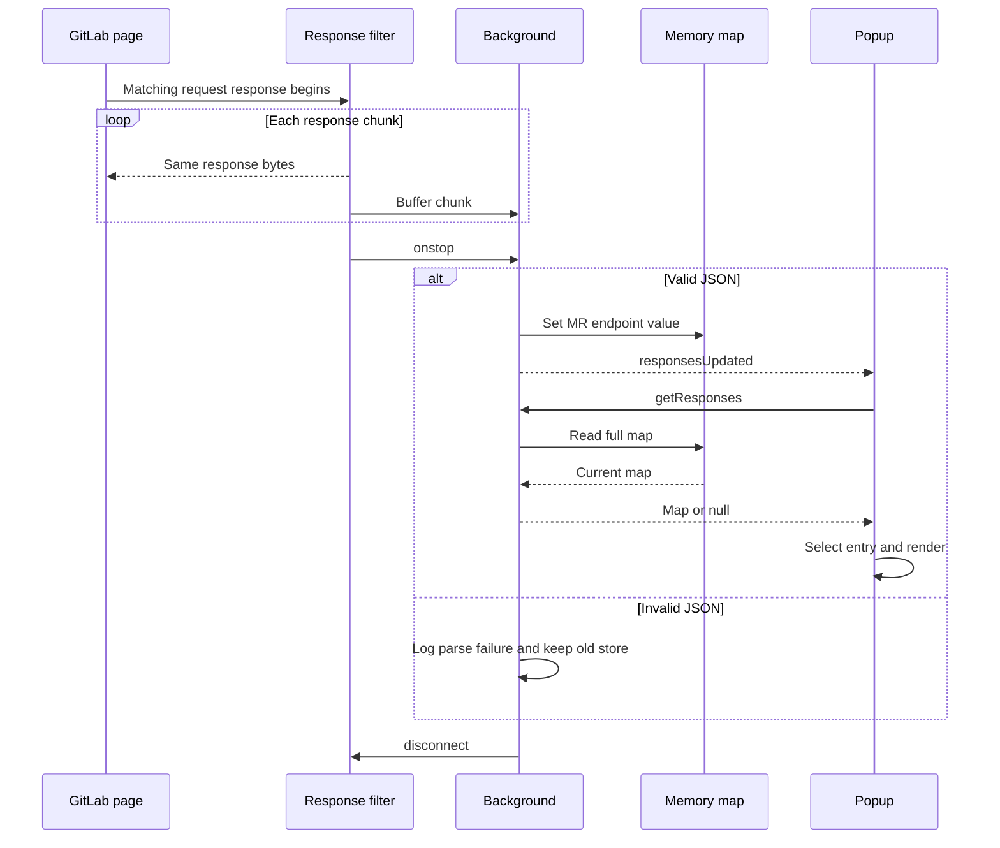
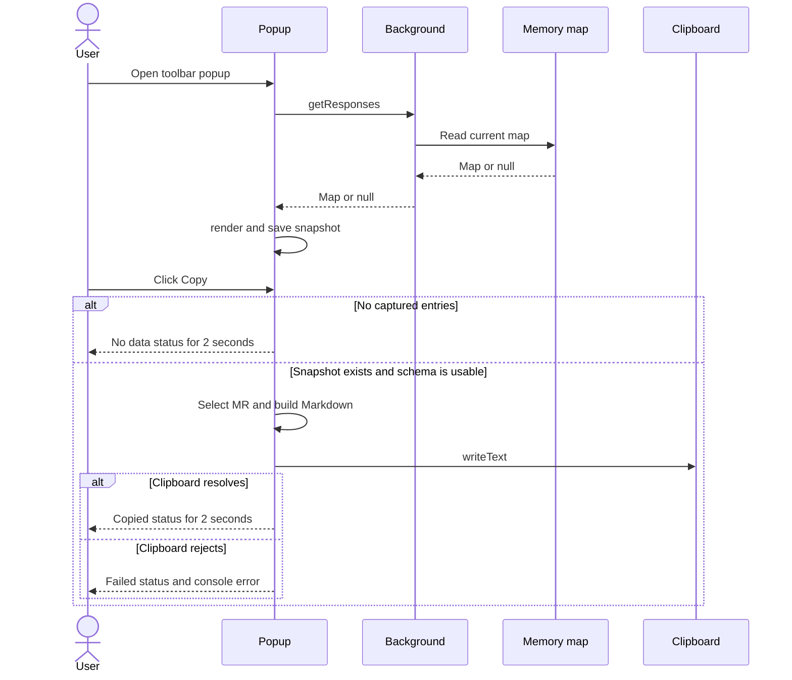
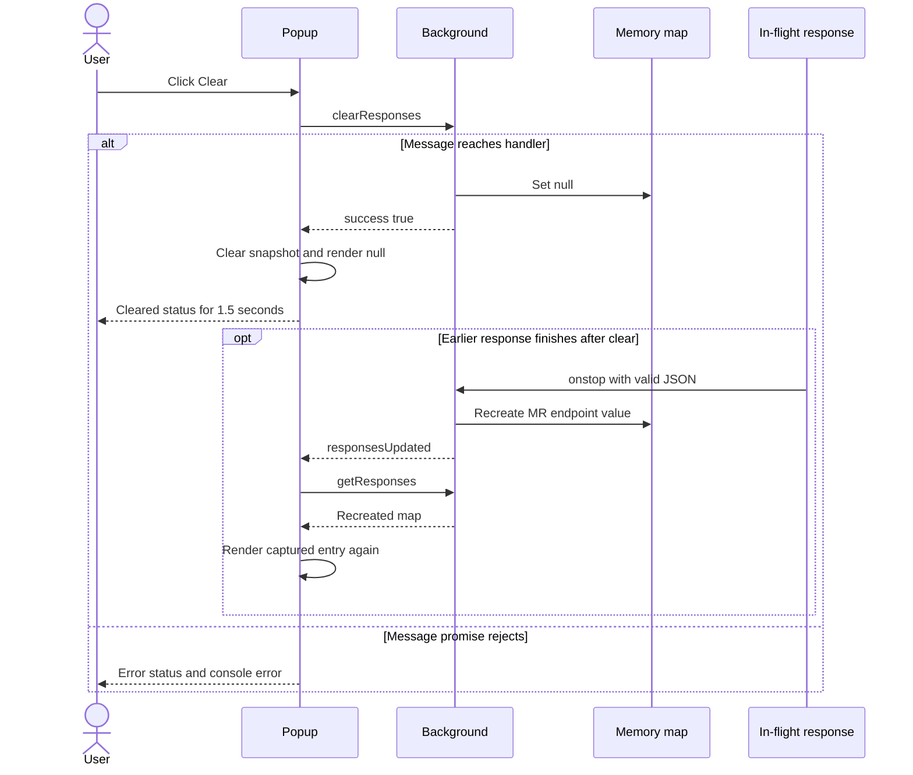

# 04 — Developer code guide

Purpose: map implementation responsibilities and explain safe feature work and tests. Intended reader: developer making a first change. Last verified against commit `9b02e7db044bfa763c69c7b956fa379ee3ddd2d0` (2026-10-15).

## Module walkthrough

| Area / key file | Responsibilities and interfaces | Dependencies / gotchas |
|---|---|---|
| Manifest — [manifest.json:2](../manifest.json#L2) | **[Verified]** Defines MV2, version, permissions, persistent background, toolbar popup, icon paths, and web-accessible CSS. | **[Verified]** Three declared icons are absent. `storage` and `tabs` are requested but not called in either JS file. |
| Capture — [background.js:7](../background.js#L7) | **[Verified]** Registers `onBeforeRequest`, matches path, attaches `filterResponseData`, forwards chunks and parses accumulated UTF-8 JSON. Browser calls it; no exported function. | **[Verified]** Native Firefox APIs, `URL`, `Uint8Array`, `TextDecoder`, `JSON.parse`; no status/schema/size validation. |
| Store/control — [background.js:36](../background.js#L36), [background.js:72](../background.js#L72) | **[Verified]** Assigns numeric MR/endpoint slots and handles `getResponses`, `clearResponses`; broadcasts `responsesUpdated` after capture. | **[Verified]** `sendResponse` callback with `return true`; store and protocol share one script. `sender` is unused. |
| Shell — [popup.html:9](../popup.html#L9) | **[Verified]** Static header, two buttons and `output` placeholder; loads JS after DOM elements. | **[Verified]** JS expects exact `output`, `clearBtn`, `copyBtn` IDs ([popup.js:1](../popup.js#L1)). |
| Render — [popup.js:8](../popup.js#L8) | **[Verified]** `render(response)` saves the reference, selects an MR, builds title/commits/files HTML; `escapeHtml(text)` returns escaped text using a temporary div. | **[Verified]** Direct GitLab schema knowledge; raw count interpolation; no DOM null guards. Missing endpoint arrays fall back to `[]`, but arbitrary non-array values are not normalized. |
| Actions — [popup.js:88](../popup.js#L88), [popup.js:121](../popup.js#L121) | **[Verified]** Async click handlers export Markdown or send clear; `showButtonStatus(button,text,className,duration)` temporarily changes labels/classes. | **[Verified]** Copy's schema traversal occurs before its clipboard try/catch. Clear tests only promise rejection, not `{error}` replies. Timers are not cancelled. |
| Sync — [popup.js:149](../popup.js#L149), [popup.js:163](../popup.js#L163) | **[Verified]** Initial `getResponses` plus a new read after every update event. | **[Verified]** Initial failure creates visible fallback; refresh failure only logs. No revision checks or periodic polling. |
| Styling — [popup.css:7](../popup.css#L7) | **[Verified]** Fixed 400px popup width, 400px max content height, cards/lists, transient success style, fade/pulse animations. | **[Verified]** No reduced-motion media rule or theme configuration in this stylesheet. |

## Three complete flows

### A. GitLab response to displayed MR

**[Verified]** Entry is a matching browser request; store is `latestResponse`; return is notification → popup read → HTML. Two endpoints can arrive independently ([background.js:7](../background.js#L7), [background.js:41](../background.js#L41), [popup.js:153](../popup.js#L153)).

**[Verified]** Caption: capture and presentation are separate asynchronous stages. How to read this: the popup branch applies when a popup receives the event; notification rejection is logged and data remains available on its next open ([background.js:50](../background.js#L50)). [Rendered SVG](diagrams/04-code-guide-1.svg).

### B. Stored response to clipboard

**[Verified]** Opening the popup reads background memory, and clicking Copy exports the popup's saved snapshot ([popup.js:9](../popup.js#L9), [popup.js:94](../popup.js#L94), [popup.js:165](../popup.js#L165)).

**[Verified]** Caption: Copy does not perform another store read. How to read this: formatting happens before the clipboard error handler; a malformed array can throw before either clipboard result branch ([popup.js:99](../popup.js#L99), [popup.js:111](../popup.js#L111)). [Rendered SVG](diagrams/04-code-guide-2.svg).

### C. Clear memory and return to empty

**[Verified]** Clear resets the entire map, not just the displayed entry, and the requesting popup renders empty when its message promise resolves ([background.js:79](../background.js#L79), [popup.js:123](../popup.js#L123)).

**[Verified]** Caption: clearing is an immediate reset, without an interception barrier. How to read this: the optional branch explains how data can return without another user click; the error branch models a rejected message promise. [Rendered SVG](diagrams/04-code-guide-3.svg).

## Conventions and inconsistencies

**[Verified]** Names use camelCase, two-space indentation and top-level `const`/`let`. The JS is loaded as plain scripts; no imports, exports, TypeScript types or dependency injection. Configuration is literal in the manifest and background script. Errors use `console.error`/`warn`; capture successes use `console.log`. UI feedback is transient text/classes rather than exceptions surfaced to the user ([background.js:43](../background.js#L43), [popup.js:135](../popup.js#L135)).

**[Verified]** Misleading comments include “Store only latest MR” despite retaining multiple keys ([background.js:3](../background.js#L3)) and “Clear button with confirmation” despite no confirm prompt ([popup.js:120](../popup.js#L120)). Render and export duplicate selection, field lookup and fallback rules ([popup.js:24](../popup.js#L24), [popup.js:94](../popup.js#L94)). Rendering displays commits before files, while export lists files before commits. **[Unknown]** No team style guide or review policy is tracked.

## Worked feature path: change the existing file summary

**[Inferred]** Use the existing changed-file counts as the worked example for a future feature that totals additions/removals. This is a proposed contribution procedure; this audit does not implement it.

1. Inspect [popup.js:54](../popup.js#L54) and [popup.js:99](../popup.js#L99) to identify the two presentation paths, then verify the upstream field types with a sanitized real response. Do not infer fields from the names alone.
2. Decide with the PM whether totals describe only received `diff_files` or all MR changes; the extension has no completeness/pagination metadata handling. Document the decision.
3. Normalize counts to finite numbers before aggregation or HTML output. An existing `|| 0` fallback is not type validation ([popup.js:65](../popup.js#L65)). Keep parsing/capture separate from UI-specific formatting.
4. Share selection/summary derivation between render and export so the new total cannot disagree across the two actions. If the message shape changes, update both [background.js:75](../background.js#L75) and the popup consumers.
5. Extend the documentation test fixture with missing, zero, malformed and nonzero counts; assert both displayed and copied results. Follow the existing harness's VM/API simulation approach in [tests/runtime.test.cjs](tests/runtime.test.cjs).
6. Run the setup guide's syntax and test commands. Load Firefox temporarily and verify the feature with real permitted traffic, Copy, Clear, partial endpoint data and multi-MR navigation.
7. Update the [data model](06-data-model.md), [integration contract](07-api-and-integrations.md) and [product inventory](05-product-guide.md) when the behavior changes.

## Testing and maintainability

**[Verified]** The original tracked tree has no tests or coverage configuration. The new documentation harness executes unchanged source via `node:vm`, mocks request filters, runtime messages, DOM text escaping and clipboard, and checks capture, pass-through, message reads, render/export, errors, identity collision, ordering and clear races. Run it with the command in [getting started](02-getting-started.md). Read [verification](verification.md) for exact results.

**[Inferred]** To add a test, create a fresh background/popup fixture per case, feed synthetic JSON using `capture` or `begin`, and assert observable store replies, output HTML or copied text. Characterization tests intentionally assert current defects; change those expectations when fixing the defect, then add regression intent. Avoid live credentials and proprietary response fixtures.

**[Unknown]** Coverage percentages, real DOM behavior, Firefox permission semantics, filter edge conditions, accessibility behavior and upstream schema compatibility are not measured by the mock harness. **[Verified]** There are no third-party declared runtime dependencies to audit for outdated versions; MV2/platform compatibility is a separate unverified concern ([manifest.json:2](../manifest.json#L2)).

**[Inferred]** The principal maintainability hotspots are `render` and Copy's parallel transformations, the shared unnormalized raw store, and literal host duplication. Unused `storage`/`tabs` permissions and public CSS exposure are configuration debt, not proof of dead modules. See prioritized, source-linked actions in [risks](09-risks-and-recommendations.md).

## Next requested feature: instance setup

**[Inferred]** Use the [instance configuration specification](11-instance-setup-plan.md) as the implementation brief for settings, optional host access, first-run UI, safe instance switching and acceptance tests. The module-impact table identifies existing entry points without inventing new implemented APIs. Start by resolving URL/permission policy and missing icon assets, then implement background configuration ownership before wiring setup UI. **[Verified]** This documentation update changes no application code; synthetic test URLs are placeholders and do not test Firefox host permission enforcement.

Next: [05 — Product guide](05-product-guide.md).
