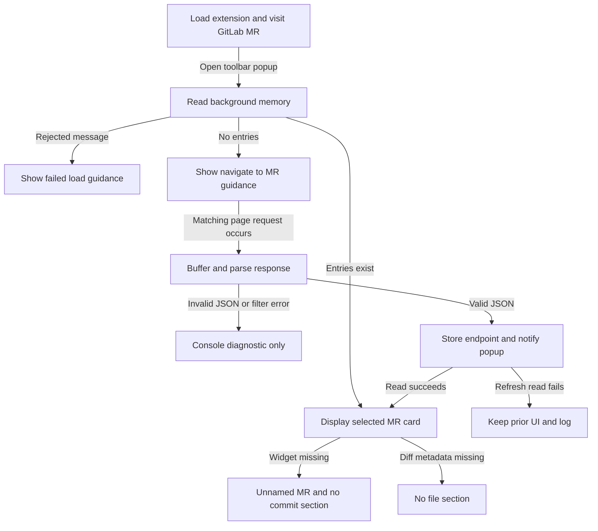
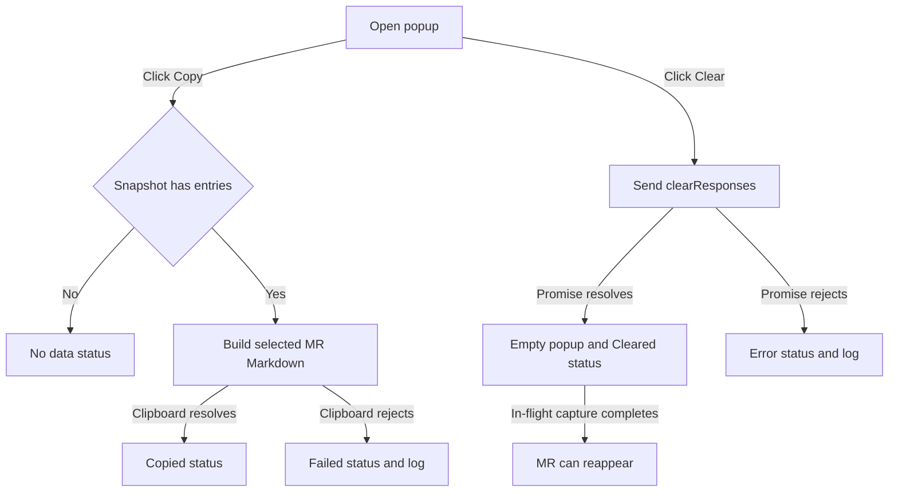

# 05 — Product behavior and user journeys

Purpose: describe the shipped source behavior, user experience and unresolved product decisions. Intended reader: product manager, designer or support teammate. Last verified against commit `9b02e7db044bfa763c69c7b956fa379ee3ddd2d0` (2026-10-15).

## Personas and permissions

**[Inferred]** The apparent persona is a developer/reviewer who already views merge requests on the configured GitLab host and wants a shareable change summary. This follows the UI's MR, commit and changed-file sections and Markdown export ([popup.js:24](../popup.js#L24), [popup.js:97](../popup.js#L97)). **[Unknown]** Actual personas, adoption, business objectives and organization-specific roles are not documented.

**[Verified]** The extension defines no user accounts, role checks, reviewer/admin distinction, login screen or token entry. Every user of the loaded extension sees the same Copy/Clear controls ([popup.html:14](../popup.html#L14)); capture is scoped by browser host permission ([manifest.json:6](../manifest.json#L6)). **[Inferred]** GitLab permissions govern which responses the page can obtain; this extension does not implement or verify those permissions. Clear removes this extension background's entire store, not GitLab server data ([background.js:79](../background.js#L79)).

## Feature inventory

**[Verified]** Status below describes source implementation, not production acceptance or a successful browser release. “Partial” identifies a concrete limitation, not an inferred roadmap.

| Feature | User type | Entry point | Status | Evidence |
|---|---|---|---|---|
| Observe MR JSON | **[Inferred]** GitLab viewer | Page request to configured host | **[Verified] Partial**: two path types, no schema validation | [background.js:1](../background.js#L1), [background.js:34](../background.js#L34) |
| MR title and number | **[Inferred]** Developer/reviewer | Toolbar popup | **[Verified] Complete** for valid expected fields; missing title uses “Unnamed MR” | [popup.js:24](../popup.js#L24) |
| Commit list | **[Inferred]** Developer/reviewer | Popup MR card | **[Verified] Complete** for provided array; excludes nothing itself beyond using upstream `commits_without_merge_commits` | [popup.js:38](../popup.js#L38) |
| File list and counts | **[Inferred]** Developer/reviewer | Popup MR card | **[Verified] Partial**: provided files only, unvalidated counts | [popup.js:54](../popup.js#L54) |
| Automatic popup update | **[Inferred]** Active popup user | Capture notification | **[Verified] Partial**: reads after event; errors only logged; no revisions | [popup.js:149](../popup.js#L149) |
| Latest/active MR | **[Inferred]** Multi-MR user | Popup selection | **[Verified] Partial**: object-last selection, no current-tab mapping | [popup.js:24](../popup.js#L24), [background.js:41](../background.js#L41) |
| Copy summary | **[Inferred]** Summary sharer | Copy button | **[Verified] Partial**: multiline Markdown and clipboard feedback exist; Markdown fields are not escaped | [popup.js:97](../popup.js#L97), [popup.js:112](../popup.js#L112) |
| Clear capture | **[Inferred]** Popup user | Clear button | **[Verified] Partial**: immediate global reset, no confirmation or in-flight barrier | [popup.js:121](../popup.js#L121), [background.js:79](../background.js#L79) |
| Empty/error guidance | **[Inferred]** New user | Popup startup | **[Verified] Complete** for empty state and rejected initial load; no host-aware guidance | [popup.js:11](../popup.js#L11), [popup.js:167](../popup.js#L167) |
| Toolbar icons | **[Inferred]** Installer/user | Manifest action | **[Verified] Partial**: referenced assets absent | [manifest.json:20](../manifest.json#L20) |

**[Verified]** No stubbed or explicitly deprecated feature is marked in current source. No analytics SDK, tracking event, feature flag, experiment assignment, A/B hook, remote config or settings UI appears in the five source files. Console logs are diagnostics, not an implemented analytics pipeline ([background.js:43](../background.js#L43), [popup.js:115](../popup.js#L115)).

## Journey: first useful capture

**[Verified]** The following paths follow rendering and capture checks ([background.js:10](../background.js#L10), [background.js:34](../background.js#L34), [popup.js:11](../popup.js#L11)). **[Unknown]** The install outcome is not measured because the manifest icon assets are missing.

**[Verified]** Caption: the product can show partial endpoint data without a loading indicator. How to read this: the two missing-endpoint branches are independent; a card can be incomplete in both ways ([popup.js:25](../popup.js#L25), [popup.js:38](../popup.js#L38), [popup.js:54](../popup.js#L54)). [Rendered SVG](diagrams/05-product-guide-1.svg).

## Journey: share and reset

**[Verified]** Copy and Clear outcomes are implemented by the two click handlers ([popup.js:88](../popup.js#L88), [popup.js:121](../popup.js#L121)); complete sequence diagrams, including store interactions and failure branches, are in the [developer guide](04-code-guide.md).

**[Verified]** Caption: status feedback is brief and capture remains active after Clear. How to read this: “promise resolves” does not mean Clear validates a `success` flag; the code ignores the reply body ([popup.js:123](../popup.js#L123)). [Rendered SVG](diagrams/05-product-guide-2.svg).

## Usability and accessibility observations

| Observation | Evidence and consequence |
|---|---|
| First-run guidance lacks host detail | **[Verified]** Empty text says to navigate to a GitLab MR without naming the one supported host ([popup.html:23](../popup.html#L23)). **[Inferred]** A user on another GitLab instance may expect unsupported capture. |
| “Latest” and status can mislead | **[Verified]** Object-last selection and an unconditional animated green dot have no active-tab, timestamp, MR status, freshness or completeness test ([popup.js:24](../popup.js#L24), [popup.js:32](../popup.js#L32), [popup.css:241](../popup.css#L241)). **[Inferred]** Users can mistake a stale card for current/healthy data. |
| Missing versus empty data is indistinguishable | **[Verified]** Arrays default to `[]` and sections are omitted when empty ([popup.js:38](../popup.js#L38), [popup.js:54](../popup.js#L54)). **[Inferred]** Users cannot tell zero changes from not-yet-captured metadata. |
| Basic button semantics exist | **[Verified]** Both controls are native buttons with text and title attributes ([popup.html:15](../popup.html#L15)); heading is an `h1` ([popup.html:10](../popup.html#L10)). **[Unknown]** Keyboard and screen-reader behavior has not been tested. |
| Dynamic announcements are absent | **[Verified]** Output and button feedback have no explicit `aria-live` or status role, and the HTML root has no `lang` ([popup.html:2](../popup.html#L2), [popup.html:19](../popup.html#L19), [popup.js:135](../popup.js#L135)). **[Inferred]** Assistive users may miss updates. |
| Fixed dimensions and motion | **[Verified]** Body width is 400px; content scrolls above 400px; fade/pulse animations have no reduced-motion override ([popup.css:7](../popup.css#L7), [popup.css:77](../popup.css#L77), [popup.css:236](../popup.css#L236)). **[Unknown]** Zoom, contrast, text scaling and reduced-motion accessibility are not measured. |
| No discovery or selection tools | **[Verified]** The popup contains only Copy/Clear and one rendered card; no MR switcher, search, link to MR, onboarding tour or host setting ([popup.html](../popup.html), [popup.js:24](../popup.js#L24)). |

## Decisions for the PM

**[Unknown]** These questions cannot be resolved from UI names or commit messages; the [risk register](09-risks-and-recommendations.md) assigns owners.

- Should the card follow the active browser tab, most recently completed capture, highest MR number, or a user selection?
- Is capture intended for multiple projects or tabs at once? Which identifiers must never be mixed?
- Should Copy produce a human-ready summary, a strict Markdown template, or exact raw data? How should untrusted Markdown be escaped?
- Should Clear cancel in-flight work, pause capture, require confirmation, or only reset the current snapshot?
- Is this an internal single-host tool or a configurable extension? What is the supported browser and deployment channel?
- How should partial, stale, paginated or schema-incompatible upstream data be explained to users?

## Requested improvement: setup and instance settings

**[Inferred]** The requested product direction is a first-run setup journey for a user-entered GitLab instance, followed by an editable saved setting. The [setup specification](11-instance-setup-plan.md) defines proposed URL validation, permission denial/retry, configured-versus-captured feedback, switch/reset behavior and accessibility acceptance criteria. **[Verified]** This is planned work and is not an additional completed feature in the inventory above. **[Unknown]** Multi-instance, subpath and HTTP development-instance support still need explicit decisions.

Next: [06 — Data model](06-data-model.md).
