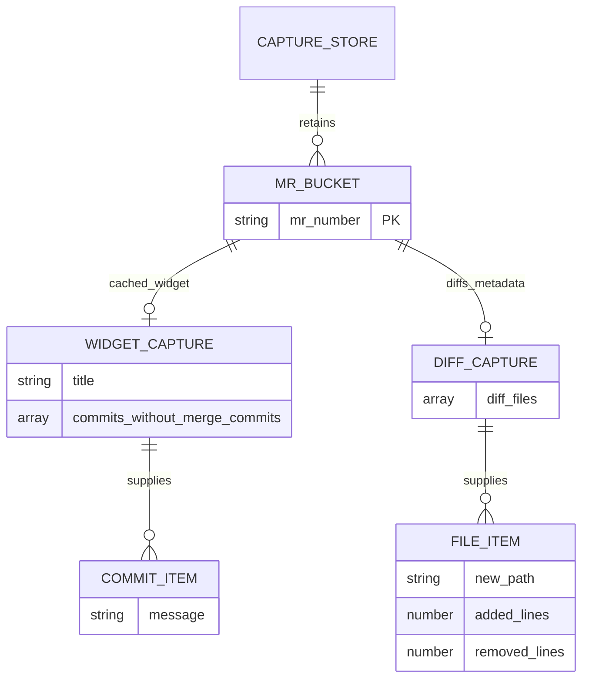
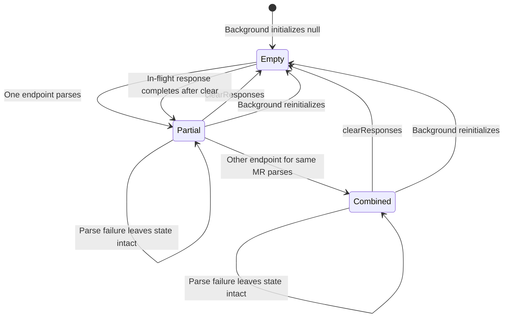

# 06 — Data model and lifecycle

Purpose: document stored values, identity, relationships, retention and lifecycle races. Intended reader: developer, architect or security reviewer. Last verified against commit `9b02e7db044bfa763c69c7b956fa379ee3ddd2d0` (2026-10-15).

## Actual storage shape

**[Verified]** Background state is initially `null`. On a successful parse it becomes an object keyed by the regex's numeric-string MR capture, then by endpoint name; values are the full `JSON.parse` results ([background.js:4](../background.js#L4), [background.js:13](../background.js#L13), [background.js:34](../background.js#L34), [background.js:36](../background.js#L36)). There is no database, migration, schema version, index, persistence adapter or serialization layer beyond JSON parsing and browser message transport.

**[Verified]** The following synthetic fixture shows a shape the popup consumes, not a guaranteed GitLab response contract. Keys and field accesses come from [popup.js:25](../popup.js#L25), [popup.js:38](../popup.js#L38), and [popup.js:54](../popup.js#L54). No real customer response is included.

```json
{
  "42": {
    "cached_widget": {
      "title": "Example change",
      "commits_without_merge_commits": [{ "message": "Example commit" }]
    },
    "diffs_metadata": {
      "diff_files": [{ "new_path": "example.js", "added_lines": 3, "removed_lines": 1 }]
    }
  }
}
```

| Entity / value | Fields and constraints actually present |
|---|---|
| Background map | **[Verified]** `null` or ordinary JS object. No total entry limit. Returned in full by `getResponses` ([background.js:75](../background.js#L75)). |
| MR bucket | **[Verified]** Key is a string matching `\d+`; no project, tab, URL, account or timestamp retained ([background.js:1](../background.js#L1), [background.js:41](../background.js#L41)). |
| Endpoint capture | **[Verified]** One current value per `diffs_metadata` or `cached_widget` slot. JSON scalar/array/null values are not rejected. Successful parse replaces the entire slot ([background.js:34](../background.js#L34), [background.js:41](../background.js#L41)). |
| Widget projection | **[Verified]** Popup reads `title` and `commits_without_merge_commits[].message`; missing/falsy title becomes “Unnamed MR”; missing/falsy message becomes “No commit message” ([popup.js:25](../popup.js#L25), [popup.js:46](../popup.js#L46)). |
| Diff projection | **[Verified]** Reads `diff_files[].new_path`, `.added_lines`, `.removed_lines`; falsy counts become `0`, without numeric type validation ([popup.js:54](../popup.js#L54), [popup.js:63](../popup.js#L63)). |
| Popup snapshot | **[Verified]** Last response passed to `render`, saved even before render completes; Copy uses it ([popup.js:9](../popup.js#L9), [popup.js:94](../popup.js#L94)). |

## Logical ER diagram

**[Verified]** This entity-relationship (ER) diagram describes the intended consumed object shape, not database tables or enforced referential integrity. Cardinalities derive from the store assignment and the two optional arrays ([background.js:41](../background.js#L41), [popup.js:38](../popup.js#L38), [popup.js:54](../popup.js#L54)).



**[Verified]** Caption: one MR bucket can receive either or both endpoint captures. How to read this: displayed types represent expected UI inputs; the code does not enforce them, and extra upstream fields remain stored. [Rendered SVG](diagrams/06-data-model-1.svg).

## Identity, ordering and consistency

**[Inferred]** MR identity is insufficient for multiple projects: `/project-a/.../merge_requests/42/cached_widget.json` and `/project-b/.../merge_requests/42/diffs_metadata.json` write the same bucket. This follows the regex capture and store indexing and is reproduced in [runtime tests](tests/runtime.test.cjs). No project-scoped uniqueness guarantee is documented. Numeric MR identifiers should not be assumed globally unique.

**[Verified]** Both render and export choose the last `Object.entries` entry ([popup.js:24](../popup.js#L24), [popup.js:94](../popup.js#L94)). **[Inferred]** For normal integer-like keys such as `2` and `100`, that selects `100` even if `2` completes later; the harness characterizes this explicitly. Other digit strings, such as leading-zero or out-of-range integer-index keys, need not share the same enumeration behavior. No capture chronology is stored.

**[Inferred]** This model allows mixed-age widget/diff data, cross-project composition, and overwrites from older requests that finish later. There is no transaction that pairs two endpoint results or request-generation guard ([background.js:24](../background.js#L24), [background.js:41](../background.js#L41)). A consumer must not interpret one card as a verified atomic MR snapshot.

## Lifecycle and retention

**[Verified]** The lifecycle includes empty, partially captured and combined endpoint states; clear resets the map but does not cancel responses ([background.js:36](../background.js#L36), [background.js:79](../background.js#L79)).



**[Verified]** Caption: combined means both slots exist, not that they are consistent or schema-valid. How to read this: map-wide empty state is global; partial/combined describes a representative MR bucket within the map. [Rendered SVG](diagrams/06-data-model-2.svg).

**[Verified]** There is no TTL, record deletion except whole-map clear, max-count policy, disk write, migration, backup or restore. A new background evaluation starts from `null` ([background.js:4](../background.js#L4)). **[Inferred]** Closing/reopening only the popup leaves background data available; extension reload/background restart loses it. Clearing extension memory does not clear previously copied clipboard text because there is no corresponding clipboard operation in the Clear handler ([popup.js:121](../popup.js#L121)).

**[Unknown]** Full upstream payload contents, sensitivity classification, maximum sizes, pagination and field stability are not established by the repository. No redaction or minimization is applied before storage. Consult [security risks](09-risks-and-recommendations.md) before introducing persistence or logging raw payloads.

## Proposed configuration record

**[Inferred]** The [instance setup plan](11-instance-setup-plan.md) proposes a separate, versioned `instanceConfig` record containing a normalized HTTPS origin in `browser.storage.local`. Captured MR JSON should remain memory-only. Clear should preserve configuration; reset or successful instance switching should invalidate captures and pending writes from the former configuration. **[Verified]** No settings record, storage migration or configuration lifecycle is implemented in the current source; the ER/state diagrams above describe existing capture data only.

Next: [07 — API and integrations](07-api-and-integrations.md).
